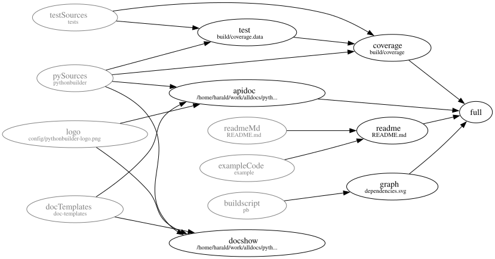

#   pythonbuilder &mdash; pythonic project builder

<!-- markdown-toc start - Don't edit this section. Run M-x markdown-toc-refresh-toc -->
**Table of Contents**

  - [Getting Started](#getting-started)
  - [Functional Overview](#functional-overview)
  - [Example](#example)

<!-- markdown-toc end -->

Quick link: [api documentation](https://harald.codeberg.page/pythonbuilder/@main/apidoc/index.html).

See also: [BuildMachine](https://codeberg.org/harald/BuildMachine),
[bashbuilder](https://codeberg.org/harald/bashbuilder)

## Getting Started

Copy `src/pythonbuilder.py` and the other `*.py` files to some place you like. The
suggested place is the subdirectory `./pythonbuilder` in your project directory.

Write a build script in Python, called `pb` (for example), which has the following
structure:
```pyton
#!/usr/bin/env python3
import sys
sys.path += ["pythonbuilder"]
from pythonbuilder import Target, updateTargets, LOG, pbexec, toGraphviz

def declareTarget() -> None:
  ... multiple calls to the Target constructor ...

... definition of functions to create your targets ...

declareTargets()
if not updateTargets(*sys.argv[1:]):
  sys.exit(1)

```

Run `./pb target` to build the given target according to the recipe described in
your build script, where target is a name of one of the `Target` objects you created.

A more extensive example, is the [our build script](./pb) or see
[below](#example).

## Functional Overview
A **target** is something you want to build. Usually it is a file or the
contents of a whole directory. To build `target1`, it may be necessary to build
`targetA` and `targetB` first. Then those two are called **dependencies** of
`target1`.

Of course a dependency can have its own dependencies too and different targets
may have the same dependencies. The result is a directed graph without
cycles. If a target directly or indirectly has itself as a dependency, this is
flagged as an error.

A target is represented by on object of class `Target`. The thing to actually
built is wrapped as the field `item` of `Target`.

To create or recreate a target, it has an associated **command**. It is a Python
function with N+1 parameters, the target's `item` as well as the `item` values
of all dependencies. If `pythonbuilder` determines that it must (re-)create a
`target1` with its command `cmd1` it will call the command as:

```python
  cmd1(target1.item, targetA.item, targetB.item)
```

If you use `mypy` or a similar type checker for Python, it helps you to match the
item types of the dependencies to the command.

When pythonbuilder analyzes a target to find out whether its command needs to be
run, we say the it **updates** the target, independent of whether the command is
run or if the target is still up-to-date anyway.  To know whether a target needs
to be updated, a target has a **state** which, internally, often is a checksum
(`hashlib.sha256()` for now) of the target's content, combined with the
check-sums of its dependencies. A target's command is run if any of the
following two conditions hold:

1. After updating all dependencies, their combined state is different from a
   previously recorded combined state.
2. The state of the target is different from a previously recorded state.

The latter makes sure that manual editing or even deletion of the target can be
detected.

If there is no previous recorded state, then the target is outdated by
definition and must be re-created.

If a dependency is created but its resulting state is the same as before, like
after it was accidentally deleted, the target will not be created unnecessarily.

## Example

A minimal example, assumed to be stored in file `pb`:
```python
#!/usr/bin/env python3
import subprocess
import sys
from pathlib import Path

sys.path += ["pythonbuilder", "src"]
from pythonbuilder import LOG, Target, updateTargets

LOG.setLevel("VERBOSE")

def declareTargets() -> None:
  ## Declare an initial target, assume it is an existing file in the project
  rmd = Target(Path("README.md"))

  ## Declare README.html as file to be created by running runPandoc
  Target(
    Path("README.html"), # target item, often file or directory name
    rmd,                 # one dependency, could be more
    name="readme",       # nicer name to use on the command line
    state="file",        # how to compute a condensed state (fingerprint, checksum)
    cmd=runPandoc        # how to create the target if it is out-of-date
  )


def runPandoc(targetPath: Path, readmeMd: Path) -> None:
  # The dependencies are in the order in which they are provided to Target below
  input = str(readmeMd)
  with open(targetPath, "w", encoding="utf-8") as outfile:
    subprocess.run(["pandoc", input], stdout=outfile)


declareTargets()
if not updateTargets(*sys.argv[1:]):
  sys.exit(1)

```

The default name of a `Target`, which has to be unique over the whole built, is
`str(Target.item)`, where `.item` is initialized by first parameter of
`Target`. In many cases it is convenient, though, to define a nice name with the
`name=` parameter, as it makes it easier to refer to a on the command line.
Given the above, you can now build `README.html` from `README.md` by running 
`python3 ./pb readme`, and the following will happen (slightly
simplified):
- The builder finds the target for `"README.html"`.
- It checks the dependencies, in this case only `"README.md"`.
- It sees that the latter has no dependencies in itself and no `cmd=` parameter,
  so there is nothing to do for this target.
- Back to `"README.html"` which was never created, so it is not up-to-date and
  its command `runPandoc` is run.

Try also the following:
- Remove `build/pbstates` to force a full rebuild.
- Set the environment variable PBLOGLEVEL to `DEBUG`, `VERBOSE`, `INFO`
(default) or `WARNING` for more or less logging.
- Experiment with
[registerDependencyGraphTarget](https://harald.codeberg.page/pythonbuilder/@main/apidoc/pythonbuilder.html#registerDependencyGraphTarget)
to create a dependency graph for your build like the one shown for this project.

See the [full
api](https://harald.codeberg.page/pythonbuilder/@main/apidoc/pythonbuilder.html)
for more information.

If you use this in a Java project, then
[mavenrepo.MavenArtifact](https://harald.codeberg.page/pythonbuilder/@main/apidoc/mavenrepo.MavenArtifact.html)
and module
[java](https://harald.codeberg.page/pythonbuilder/@main/apidoc/java.html)
might be interesting too.

## Dependency Graph of pythonbuilder's build

